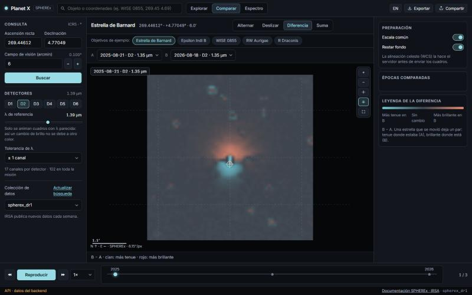

# SPACECORE

**Watch the infrared sky change.** SPACECORE is a web tool for the
**"Planet X and SPHEREx"** challenge of the NASA Space Apps Challenge 2026.

Type sky coordinates (RA/Dec) or an object name and SPACECORE shows the images that NASA's
**SPHEREx** mission took of that patch of sky on different dates. Played back as a short
animation ("blink"), they reveal objects that **move** (nearby stars, brown dwarfs, asteroids) or
**change brightness** (variable stars).

**Live demo: <https://spacecore.vercel.app>**



*Barnard's Star in the Explore view: the first of three SPHEREx epochs (21 August 2025, detector
D2) at the centre, the timeline of epochs at the bottom and the same field in Aladin Lite on the
right. Press **Play** to blink through the epochs and watch the star move.*

## Contents

- [What it does](#what-it-does)
- [Try it](#try-it)
- [How it works](#how-it-works)
- [NASA data and other resources](#nasa-data-and-other-resources)
- [Run it locally](#run-it-locally)
- [Repository layout](#repository-layout)
- [Limitations](#limitations)
- [Use of AI tools](#use-of-ai-tools)
- [Credits](#credits)

## What it does

- **Search** by object name or by coordinates, in decimal degrees (`269.45 4.69`) or sexagesimal
  (`08h55m10.831s -07d14m42.53s`).
- **Blink** one clean image per observing epoch, for each of the six SPHEREx detectors (D1 to D6,
  0.75 to 5 µm). Images of the same epoch are aligned and combined to improve the signal.
- **Compare** two epochs: swipe slider, difference (B − A) and sum.
- **Spectrum on the fly**: click a source and get its flux versus wavelength, measured with
  aperture photometry on every SPHEREx image that covers it. The aperture follows the star's
  proper motion.
- **Sky context** with Aladin Lite: DSS2 or the SPHEREx all-sky map as background, with Gaia DR3
  and AllWISE sources overlaid.
- **Choose the field of view**, from 1.5′ to 30′.
- **Share**: the target, detector, epochs and view are stored in the URL, and there is an embed
  mode (`?embed=1`).
- **Export** the current image (PNG) and the spectrum (CSV).
- **Bilingual interface**: English and Spanish.

## Try it

Open the [live demo](https://spacecore.vercel.app) and pick one of the five example targets. They
are the test objects named by the challenge, and they load instantly at the default 6′ field of
view because their results are pre-computed.

| Target | What to look for |
|---|---|
| Barnard's Star | Fastest proper motion of any star. Press **Play** and watch it move while the others stay still. |
| Epsilon Indi B | Brown dwarf pair near a bright star. |
| WISE 0855 | Very cold, fast-moving brown dwarf. Best seen in detector D6. |
| RW Aurigae | Young variable star (T Tauri type) with irregular brightness changes. |
| R Draconis | Mira-type variable. Very bright: its core saturates in some detectors, so try several. |

Any other object or position also works. A new search queries the NASA archive live and can take
up to a minute the first time; after that it is served from the cache.

## How it works

```
Browser: TypeScript + Vite, HTML Canvas, Aladin Lite, Plotly        (hosted on Vercel)
        |  HTTP GET, JSON
        v
API: Python + FastAPI in Docker                                     (hosted on Google Cloud Run)
        |-- IRSA (NASA/IPAC): image search (SIA) and FITS cutout service
        |-- CDS Sesame: object name -> coordinates
        |-- Cache: disk + Redis
```

There is no database. IRSA is the data source and the backend only stores what it has already
computed.

**From a search to an animation**

1. **Find the images.** The backend asks IRSA which SPHEREx images contain the point. One query
   returns all six detectors.
2. **Group them into epochs.** SPHEREx revisits each part of the sky about every six months, so
   images arrive in clusters. A gap of more than 30 days starts a new epoch.
3. **Download cutouts.** Only the image part of each FITS cutout is downloaded (about 125 KB
   instead of 3.9 MB), several at a time, with retries.
4. **Align.** Each cutout comes rotated. All of them are reprojected onto one common grid: centred
   on the target, north up, east left, 6.15″ per pixel (the SPHEREx pixel size).
5. **Combine.** The images of each epoch are background-subtracted and median-combined, which
   removes cosmic rays and bad pixels.
6. **Render.** Every epoch is drawn with the same brightness scale, so a change you see in the
   animation is real and not an artefact of the scaling.

**Spectrum.** In SPHEREx each detector pixel sees a different wavelength, so every image that
covers a star measures it at one wavelength. SPACECORE measures the star in up to 40 images per
detector and plots flux (mJy) against wavelength.

**Speed and reliability.** Results are cached on disk and in Redis. The five example targets are
pre-computed and shipped inside the backend image, so the demo keeps working even if the archive
is slow or unavailable.

The API has six endpoints: `/health`, `/resolve`, `/epocas`, `/frames`, `/diff` and `/spectrum`.
The contract is in [`docs/api.md`](docs/api.md) (in Spanish), and the running backend serves
interactive documentation at `/docs`.

## NASA data and other resources

**NASA data**

| Resource | How SPACECORE uses it |
|---|---|
| **SPHEREx spectral images**, collections `spherex_dr1` and `spherex_qr3` | The images and spectra shown by the tool. Found with the IRSA Simple Image Access (SIA) service and downloaded through the IRSA cutout service. |
| **SPHEREx all-sky HiPS cube** (102 wavelength layers) | Optional background of the sky map. |
| **NASA/IPAC Infrared Science Archive (IRSA)** | Hosts and serves all of the above, plus the DSS2 background map. |
| **AllWISE source catalogue** (NASA's WISE mission) | Catalogue overlay on the sky map. |
| **IRSA SPHEREx tutorials** | Reference for the archive queries and the wavelength calculation. <https://caltech-ipac.github.io/irsa-tutorials/spherex/> |

**Other data and services**

| Resource | How SPACECORE uses it |
|---|---|
| **Gaia DR3** (ESA) | Catalogue overlay on the sky map. |
| **VizieR** (CDS; mirror at the Harvard-Smithsonian CfA) | Serves the Gaia DR3 and AllWISE catalogues. |
| **Sesame name resolver** (CDS) | Converts object names into coordinates. |
| **DSS2** | Default optical background of the sky map. |

**Open-source software**

Backend: Python 3.13, FastAPI, Uvicorn, Astropy, Astroquery, PyVO, NumPy, reproject, Pillow,
httpx, Redis. Frontend: TypeScript, Vite, Aladin Lite v3, Plotly.js. Infrastructure: Docker,
Google Cloud Run, Vercel, Upstash Redis.

**Inspiration.** [WiseView](http://byw.tools/wiseview), which does the same for the WISE mission
and is the reference named by the challenge.

## Run it locally

You need **Python 3.13** and **Node.js 20 or later**. The commands are for Windows PowerShell; on
macOS or Linux, activate the virtual environment with `source .venv/bin/activate`.

### Backend

```powershell
cd backend
python -m venv .venv
.venv\Scripts\Activate.ps1
pip install -r requirements.txt
uvicorn app.main:app --reload
```

Open <http://127.0.0.1:8000/health>; you should see `{"status":"ok"}`. The interactive API
documentation is at <http://127.0.0.1:8000/docs>.

| Task | Command (from `backend/`) |
|---|---|
| Run without contacting IRSA (fake data) | `$env:USAR_MOCK="1"` before `uvicorn` |
| Run the automated tests | `python -m unittest discover -v` |
| Pre-compute the five example targets | `python -m scripts.precalcular` |

Settings are read from `backend/.env`; copy `backend/.env.example` to start.

### Frontend

```powershell
cd frontend
npm install
npm run dev
```

Open <http://localhost:5173/?api=http://127.0.0.1:8000> to use your local backend. Without the
`api` parameter (and without `VITE_API_URL` in `frontend/.env`) the page runs in **demo mode**
with simulated data, which is clearly labelled on screen.

### Everything with Docker

```powershell
copy backend\.env.example backend\.env
docker compose up -d --build
```

This starts Redis, the backend on port 8000 and the page on port 5173.

### Deployment

The backend runs on Google Cloud Run and the page on Vercel, which redeploys on every change to
`main`. The step-by-step guide is in [`infra/despliegue.md`](infra/despliegue.md) (in Spanish).

## Repository layout

| Folder | Contents |
|---|---|
| `backend/` | API in Python with FastAPI: archive access, image processing, cache and tests |
| `frontend/` | Web page in TypeScript with Vite, Aladin Lite and Plotly |
| `docs/` | API contract (`api.md`) and screenshots (`capturas/`) |
| `infra/` | Deployment guide and Cloud Run settings |
| `notebooks/` | Science experiments and sample outputs |

`docs/PROGRESO.md`, `CLAUDE.md` and `docs/plan` are internal working notes in Spanish. Code
comments and API field names are also in Spanish.

## Limitations

- Images and spectra are meant for **visual exploration**. They are not calibrated photometry:
  the spectrum uses simple aperture photometry with no PSF correction.
- Very bright stars saturate the detector. Their cores are filled in for display, and their
  measured flux is a lower limit (those spectrum points are drawn as hollow circles).
- Only the five example targets at a 6′ field of view are pre-computed. Anything else depends on
  the archive responding, which can be slow or fail temporarily.
- Proper motion is known only for the five example targets.
- The cache does not refresh by itself when SPHEREx publishes new data; the pre-computation has to
  be run again.
- Data quality flags are not shown yet.

## Use of AI tools

We used two AI coding assistants during the hackathon: **Claude Code** (Anthropic) and **Codex**
(OpenAI). We are a team of students taking part in our first hackathon, and we used them to
build and to learn at the same time.

Where AI assistance was used:

- **User interface.** Layout, components, styles and the English/Spanish texts of the web page.
- **Backend code and tests.** The API, the archive access, the image and spectrum processing and
  the unit tests were written with AI assistance, working task by task from our plan.
- **Deployment and testing.** Docker and cloud configuration, and the quality checks of the
  published page.
- **Documentation.** The API contract, our internal working notes and this README.

What AI was not used for:

- **No image, spectrum or measurement in SPACECORE is AI-generated.** Everything shown in the
  live tool is computed from real SPHEREx data served by IRSA. The offline demo mode uses
  simulated data produced by ordinary code, and says so on screen.
- The team chose the idea, the technologies and the design, reviewed the changes through pull
  requests, and tested the results against real archive data and the official IRSA tutorials.

`CLAUDE.md` in this repository is the instruction file we gave to Claude Code, and many commits
are co-authored by it.

## Credits

- This work uses data from **SPHEREx**, a NASA mission, obtained from the **NASA/IPAC Infrared
  Science Archive (IRSA)**, operated by the California Institute of Technology.
- It uses data products from the **Wide-field Infrared Survey Explorer (WISE)**, a NASA mission,
  and from the European Space Agency (ESA) mission **Gaia**.
- It uses the **VizieR** catalogue service and the **Sesame** name resolver of the CDS,
  Strasbourg, France, and **Aladin Lite**, developed at CDS.
- It uses **Astropy**, a community-developed core Python package for astronomy.
- Built for the **NASA Space Apps Challenge 2026**, challenge "Planet X and SPHEREx".
